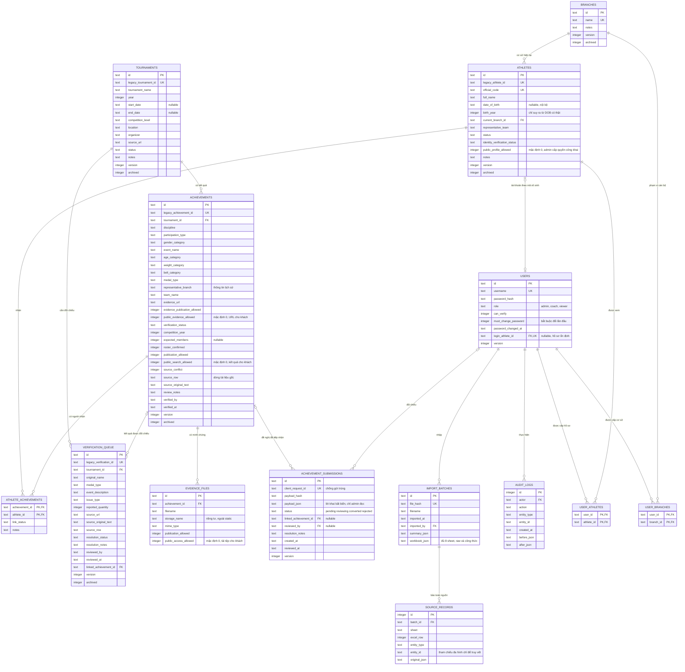
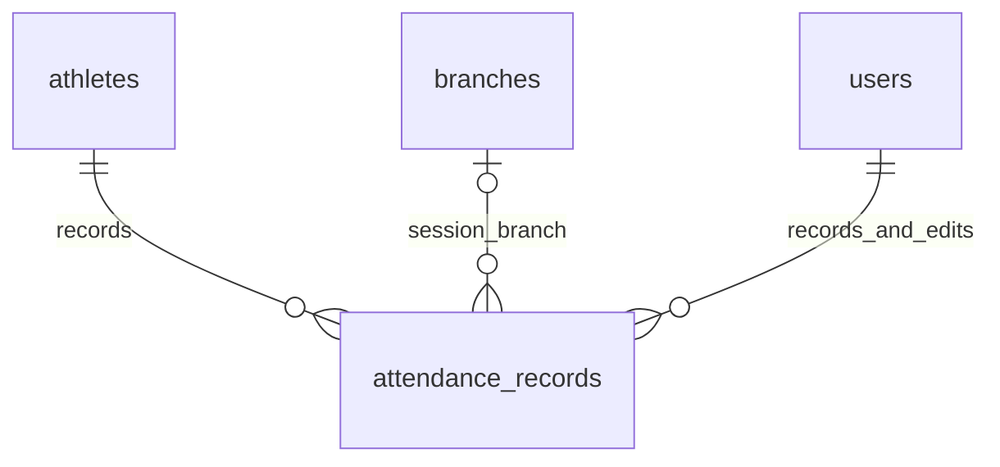

# Sơ đồ quan hệ và nguyên tắc dữ liệu



Sơ đồ thể hiện quan hệ nghiệp vụ và những trường chính. `app/schema.sql` là nguồn chuẩn cho tên cột, ràng buộc, index và các bảng phiên đăng nhập trong bản triển khai.

## Khóa, quyền và lịch sử

- UUID nội bộ không phụ thuộc tên/mã tạm. `official_code` được cấp sau khi nhận diện, duy nhất khi có giá trị. Tên không phải khóa duy nhất.
- `UNIQUE(achievement_id, athlete_id)` ngăn đếm cùng liên kết hai lần. Khóa ngoại không cho nhập mã tham chiếu không tồn tại.
- `file_hash` duy nhất giúp nhập lại cùng file không tạo trùng. File đổi nhưng dùng lại mã gốc phải được kiểm tra, không ghi đè tự động.
- `version` thực hiện khóa lạc quan: lưu với phiên bản cũ bị trả lỗi xung đột. Chỉnh sửa/xác minh ghi audit. Xóa nghiệp vụ dùng lưu trữ (`archived`), giữ dữ liệu lịch sử.
- `source_records` là hồ sơ nguồn bất biến theo batch, gồm tên sheet, dòng Excel, raw và công thức. `source_row` ở kết quả/hàng chờ là dòng tài liệu Word gốc, không thay thế `excel_row`.
- Cơ sở hiện tại thuộc võ sinh. Cơ sở/đội thi đấu thuộc từng kết quả. Đổi cơ sở hiện tại không làm thay đổi thông tin tại giải cũ.
- Tài khoản viewer chỉ truy cập UUID võ sinh được cấp. Backend kiểm tra quyền ở từng API và file minh chứng; dữ liệu ngày sinh đầy đủ và nguyên văn nội bộ không nằm trong payload viewer.
- Student Portal chỉ đọc kết quả đã xác minh và được phép công bố. Tên đồng đội khác và minh chứng chỉ được trả khi quyền tương ứng cho phép.

## Công thức thống kê

```sql
-- Một huy chương đôi/đồng đội được đếm một lần cho CLB.
SELECT medal_type, COUNT(*)
FROM achievements
WHERE verification_status = 'verified' AND archived = 0
GROUP BY medal_type;

-- Tổng lượt ghi nhận cho võ sinh được tính riêng.
SELECT a.medal_type, COUNT(*)
FROM achievements a
JOIN athlete_achievements aa ON aa.achievement_id = a.id
WHERE a.verification_status = 'verified' AND a.archived = 0
  AND aa.link_status = 'verified'
GROUP BY a.medal_type;
```

Ví dụ ba võ sinh nhận cùng HCV đồng đội: một dòng `achievements`, ba dòng `athlete_achievements`, tổng CLB bằng 1, tổng lượt cá nhân bằng 3. Tổng võ sinh/giải của một hồ sơ đếm UUID giải khác nhau, không đếm số dòng kết quả.

Các truy vấn vận hành còn áp dụng phạm vi được cấp, điều kiện dữ liệu hợp lệ và điều kiện công bố của người xem. Dữ liệu pending có thống kê riêng và không cộng vào tổng chính thức.

## Lớp dữ liệu và tích hợp

Giao diện gọi API xác thực; logic nghiệp vụ kiểm tra quyền, điều kiện xác minh, version và audit; repository SQLite lưu quan hệ và truy xuất nguồn. Importer chỉ nhận kết nối SQLite từ caller, không tự commit transaction, không chạy công thức và không gọi Google.

Google Sheets là lớp tích hợp tùy chọn phía backend. Google Drive lưu minh chứng theo quyền. Chưa có credentials thì hệ thống tiếp tục vận hành bằng SQLite và Excel, không giả định đã đồng bộ. Xem cấu hình tích hợp trong README và adapter. Dữ liệu kéo từ Google cần qua staging/đối chiếu version trước khi ghi; đường dẫn tài liệu không tự cấp quyền truy cập hoặc quyền công bố.
## Mở rộng điểm danh



attendance_records lưu ngày, giờ, lớp, cơ sở tại buổi học, trạng thái, ghi chú cho gia đình, người nhập/sửa, phiên bản và dấu lưu trữ. Unique (athlete_id, session_date, start_time, class_name) với bản ghi chưa lưu trữ. Không tạo danh bạ phụ huynh hoặc lịch học.
