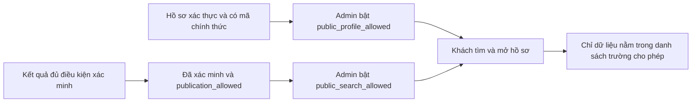

# Trang tra cứu dành cho khách

## Đường dẫn

| Đường dẫn | Chức năng |
| --- | --- |
| `/`, `/tra-cuu` | Trang khách không yêu cầu đăng nhập, tìm tên hoặc mã chính thức |
| `/?q=<tu-khoa>&page=1` | Liên kết kết quả tìm kiếm; tối thiểu 2, tối đa 100 ký tự |
| `/ho-so/<athlete-id>` | Hồ sơ công khai và lịch sử huy chương; mã UUID không tự tạo quyền xem |
| `/admin/` | Không gian quản trị cũ, yêu cầu tài khoản |

Các bookmark cũ dạng `/#queue` hoặc `/#dashboard` được chuyển sang đường dẫn quản trị. Tên giống nhau luôn là các hồ sơ riêng, phân biệt bằng mã chính thức.

## Quyền công bố

| Bảng | Cột mới | Mặc định | Tác dụng |
| --- | --- | --- | --- |
| athletes | public_profile_allowed | 0 | Cho phép công bố tên và mã chính thức, tra cứu và mở hồ sơ |
| achievements | public_search_allowed | 0 | Cho phép hiển thị kết quả đã xác minh trên trang khách |
| achievements | public_evidence_allowed | 0 | Cho phép trả URL minh chứng; vẫn cần evidence_publication_allowed |
| evidence_files | public_access_allowed | 0 | Cho phép tải tệp không cần đăng nhập; vẫn cần publication_allowed |

`init_db` nâng cấp database có sẵn bằng các cột mặc định 0; không thay đổi hồ sơ, liên kết, lịch sử và trạng thái xác minh cũ. Quyền cũ chỉ phục vụ tài khoản đã đăng nhập, không được tự chuyển thành quyền công khai.

`Service.set_publication` chỉ dành cho admin, yêu cầu phiên hợp lệ, CSRF và phiên bản bản ghi hiện hành. Mỗi thay đổi có audit. Bật công bố kết quả không đồng nghĩa với xác minh và không tự cộng thêm huy chương.

`PublicPortal` là lớp đọc độc lập với `Service` có đăng nhập. Mỗi yêu cầu kiểm tra lại điều kiện hồ sơ/kết quả, trạng thái liên kết và các điều kiện xác minh hiện hành; dữ liệu trả về theo danh sách trường cố định. Hồ sơ hoặc kết quả không đủ quyền trả 404, không tiết lộ có tồn tại hay không. Kể cả admin đang đăng nhập, gọi API công khai vẫn chỉ nhận dữ liệu công khai.

Một huy chương đồng đội được tính một lần trong thống kê công bố. Lượt võ sinh công bố tính theo số thành viên có hồ sơ được công bố, có thể ít hơn tổng lượt nội bộ. Thành viên chưa cho phép công bố bị loại khỏi danh sách tên; không công bố cả chuỗi tên đội lấy từ nguồn nội bộ.

## API chỉ đọc

Các API tra cứu dưới đây chỉ đọc. Ngoại lệ mới `POST /api/public/submissions` tiếp nhận lời khai bổ sung vào bảng riêng; không sửa hồ sơ, kết quả hoặc quyền công bố. Xem [PARENT_CONTRIBUTIONS.md](PARENT_CONTRIBUTIONS.md) cho phân quyền và luồng tiếp nhận.

| API GET | Nội dung |
| --- | --- |
| `/api/public/summary` | Số hồ sơ, giải đấu, kết quả, HCV/HCB/HCĐ và lượt võ sinh được công bố |
| `/api/public/athletes?q=...&page=1&limit=12` | Tìm kiếm không phân biệt dấu/hoa thường; tối đa 24 hồ sơ mỗi trang; không dùng wildcard |
| `/api/public/athletes/<id>` | Tên, mã chính thức và các kết quả công bố; thống kê được tính lại |
| `/api/public/achievements/<id>` | Nội dung thi đấu, giải/năm, huy chương, hình thức, thành viên và minh chứng được công bố |
| `/api/public/evidence/<id>` | Tải file PDF/PNG/JPEG đủ quyền dưới dạng attachment, tên file trung tính |

Không có endpoint công khai để sửa dữ liệu, đọc nguồn, xuất dữ liệu hay truy cập danh sách nội bộ. Không trả ngày/năm sinh, mã tạm, cơ sở hiện tại, ghi chú, người xét duyệt, tên file nguồn hay đường dẫn lưu trữ. Các response có `Cache-Control: no-store`; tắt quyền có hiệu lực cho lần truy cập mới. Trang có `noindex,nofollow`; đây không phải biện pháp bảo vệ dữ liệu thay cho kiểm tra quyền.

Mỗi tiến trình giới hạn 60 yêu cầu công khai/phút theo địa chỉ kết nối, có giới hạn kích thước bảng theo dõi. Khi đặt sau proxy/nhiều worker cần bổ sung rate limit theo IP tại proxy. Không đọc tùy tiện `X-Forwarded-For` do khách gửi. Chỉ giữ bộ đếm trong bộ nhớ; không ghi từ khóa/tên vào access log ứng dụng.

## Giới hạn triển khai

Mã nguồn có đầy đủ UI và backend để chạy cùng origin. Chưa cấu hình hosting, tên miền hay chuyển dữ liệu thật lên máy chủ. GitHub chỉ lưu mã nguồn, không phục vụ ứng dụng Python này. Khi triển khai, giữ cả `/api`, `/static`, `/ho-so` và `/admin` trên cùng ứng dụng WSGI có HTTPS và lưu trữ bền; tham khảo [DEPLOYMENT.md](DEPLOYMENT.md).

Trang khách có thể trống dù dữ liệu nội bộ đã có: đó là trạng thái đúng khi chưa có hồ sơ/kết quả được xác minh và cấp quyền công bố. Không tự công bố dữ liệu để lấp trạng thái trống.
